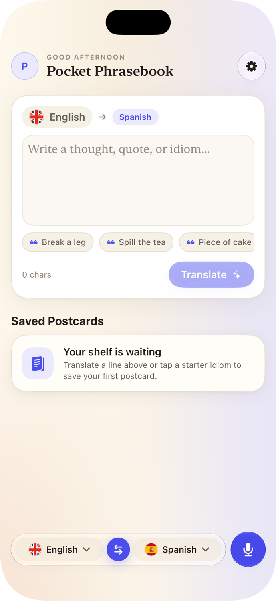
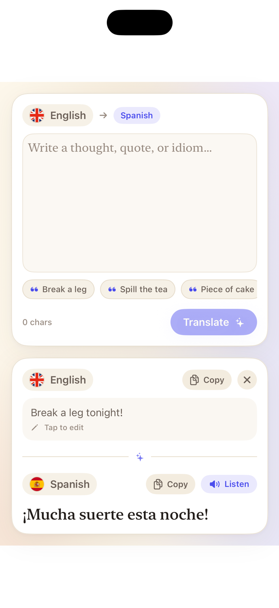
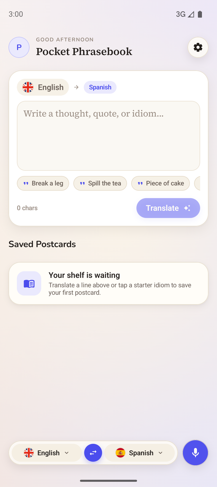
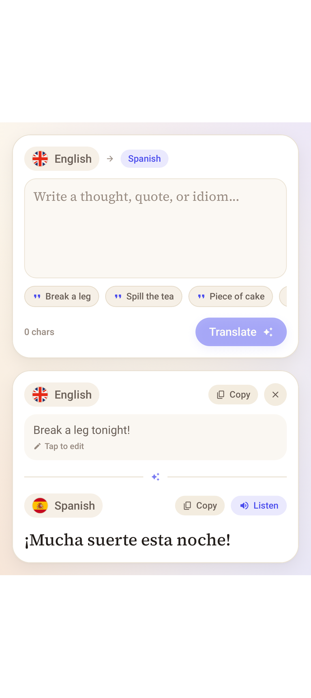
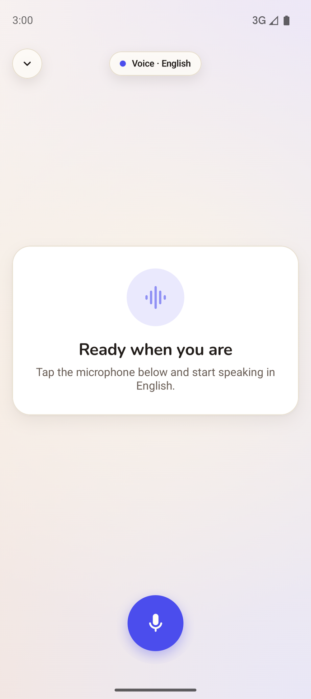
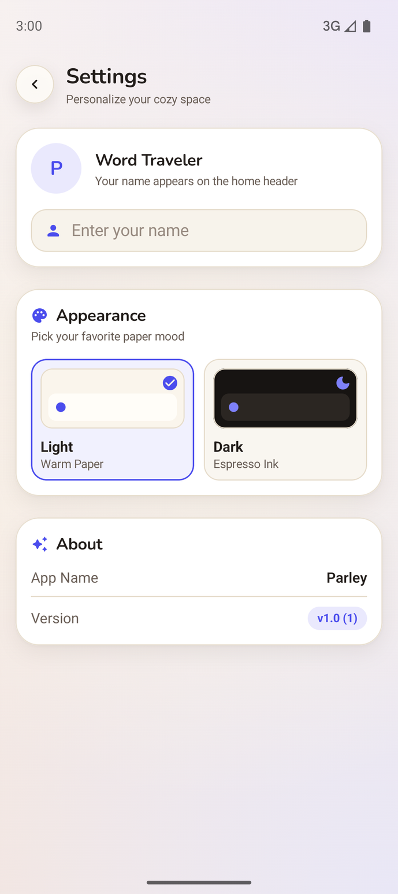
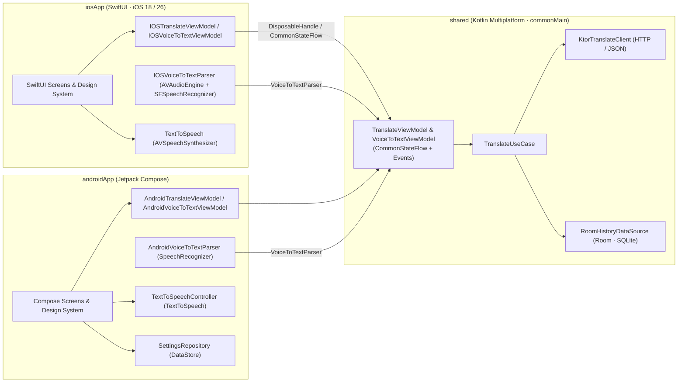

# Parley — Kotlin Multiplatform Translator

**Parley** is a cross-platform translation and voice-to-text application built with **Kotlin Multiplatform Mobile (KMM)**, **SwiftUI**, and **Jetpack Compose**. All networking, persistence, domain use cases, and presentation state machines live once in a shared Kotlin module, while each mobile app delivers a 100% native platform UI and speech/audio pipeline.

> Built as a portfolio showcase demonstrating production-minded KMM architecture: unidirectional event-driven ViewModels bridged to SwiftUI Combine/ObservableObject and Jetpack Compose, platform `expect`/`actual` drivers, a shared **Warm Paper & Indigo** design language implemented natively on both platforms (SwiftUI + iOS 26 Liquid Glass chrome, Jetpack Compose + Material 3), and comprehensive unit + UI testing across platforms.

---

## Screenshots

Both apps share one design language: same palette, typography, layout, copy and states, each built with its platform's native UI toolkit.

### iOS · SwiftUI

| Home & Quick Phrases | Translator Card States | Voice-to-Text & Diagnostics | Profile & Appearance Settings |
| :---: | :---: | :---: | :---: |
|  |  |  |  |

### Android · Jetpack Compose

| Home & Quick Phrases | Translator Card States | Voice-to-Text & Diagnostics | Profile & Appearance Settings |
| :---: | :---: | :---: | :---: |
|  |  |  |  |

---

## Features

- **10-Language Bidirectional Translation**: Translate between English, Arabic, Azerbaijani, Chinese, French, German, Italian, Japanese, Korean, and Spanish with instant language swapping.
- **Voice-to-Text Capture & Live Waveform**: Native speech recognition (`SFSpeechRecognizer` + `AVAudioEngine` on iOS; `SpeechRecognizer` on Android) paired with a real-time normalized microphone power meter, actionable missing-permission diagnostics (in-app microphone request or one-tap redirect to system Settings), and speech-service availability checks on Android.
- **Text-to-Speech Playback**: Native `AVSpeechSynthesizer` (iOS) and Android `TextToSpeech` playback directly from translation output cards, automatically cancelling stale utterances when switching languages or clearing text.
- **Offline Phrasebook & My Words**: 25 everyday phrases (greetings, courtesy, conversation, travel, food) with built-in translations for all 10 languages. Tapping one shows its translation instantly, with no network needed. Bookmark phrases to **My Words** per language pair, and remove them with the ✕ button or a swipe. Saved words are stored with Room.
- **Persistent Translation History**: Local persistence powered by **Room** (Kotlin Multiplatform, bundled SQLite) with reactive `Flow` history streams and one-tap reload into the active editor. History saved by earlier SQLDelight-based versions is imported automatically on first launch.
- **Profile & Appearance Settings**: A personal name for the home greeting plus a Light (Warm Paper) / Dark (Espresso Ink) theme, persisted with `UserDefaults` on iOS and Jetpack DataStore on Android.
- **"Warm Paper & Indigo" Design System on both platforms**:
  - **iOS**: animated `MeshGradient` ambient backdrop (respecting `accessibilityReduceMotion`), staggered card entrances, haptic feedback, and iOS 26 Liquid Glass floating chrome with iOS 18 material fallbacks.
  - **Android**: the same tokens in Compose (`CozyTheme`), a drifting radial-glow backdrop (respecting the system animator scale), spring-based press and entrance motion, haptics, edge-to-edge layout, and bundled open fonts (Nunito, Source Serif 4).

---

## Architecture

Parley follows **Clean Architecture** paired with **Unidirectional Data Flow (UDF)**:

1. **Domain Layer (`commonMain`)**: Pure Kotlin models (`Language`, `HistoryItem`, `TranslateError`), use cases (`TranslateUseCase`), and platform-agnostic contracts (`TranslateClient`, `HistoryDataSource`, `VoiceToTextParser`).
2. **Data Layer (`commonMain` + `expect`/`actual`)**: `KtorTranslateClient` (HTTP client backed by platform engines `ktor-client-darwin` / `ktor-client-android`) and `RoomHistoryDataSource` (a Room 3 `TranslatorDatabase` on the bundled SQLite driver; only the database file location is platform-specific).
3. **Shared Presentation Layer (`commonMain` + `iosMain`)**: `TranslateViewModel` and `VoiceToTextViewModel` consume sealed `TranslateEvent` / `VoiceToTextEvent` actions and expose reactive state via `CommonStateFlow<T>`. On iOS, `IOSMutableStateFlow` + `DisposableHandle` bridge Kotlin coroutines safely onto Swift `@MainActor` `ObservableObject` wrappers (`IOSTranslateViewModel`, `IOSVoiceToTextViewModel`).
4. **Native Platform UI**:
   - **iOS**: SwiftUI screens (`TranslateScreen`, `VoiceToTextScreen`, `SettingsScreen`) powered by a zero-KMM-dependency `design_system` module and manual `AppModule` composition root exported from `shared`.
   - **Android**: Jetpack Compose screens (`TranslateScreen`, `VoiceToTextScreen`, `SettingsScreen`) built on a `core/designsystem` package that mirrors the iOS one, with type-safe Navigation Compose routes and **Hilt** dependency injection.



---

## Tech Stack

| Layer | Technology / Library | Version / Notes |
| :--- | :--- | :--- |
| **Multiplatform Core** | Kotlin Multiplatform Mobile (KMM) | Kotlin `2.4.21`, Gradle `9.9.1`, CocoaPods integration |
| **Networking** | Ktor Client (`core`, `content-negotiation`, `kotlinx-json`, `darwin`, `android`) | `3.6.1` |
| **Local Persistence** | Room KMP (`room3-runtime`, KSP `room3-compiler`) + `androidx.sqlite:sqlite-bundled` | Room `3.0.3`, schema exported to `shared/schemas/` |
| **Async & Dates** | Kotlinx Coroutines, Kotlinx DateTime | Coroutines `1.11.0`, `kotlinx-datetime 0.8.0` |
| **iOS UI & Audio** | SwiftUI, Observation/Combine, `AVFoundation`, `Speech` | iOS `18.0+` (`#available(iOS 26.0, *)` Liquid Glass) |
| **iOS Testing** | Swift Testing (`@Suite`, `@Test`) | 66 unit & snapshot/render tests (`iosAppTests`) |
| **Android UI & DI** | Jetpack Compose (BOM `2026.09.00`), Material 3, Navigation Compose `2.10.2`, DataStore `1.3.0`, Hilt `2.60.1`, KSP `2.3.14` | AGP `9.5.1` (built-in Kotlin), compileSdk 37.2, minSdk 24 |
| **Android Testing** | JUnit 4, Robolectric `4.18` + Compose UI Test, Hilt testing | JVM screen/unit tests + instrumented E2E suites |
| **Shared Testing** | `kotlin-test`, `AssertK 0.28.1`, `Turbine 1.2.1` | `commonTest` runs on the JVM and the iOS simulator |

---

## Project Structure

```text
KMMTranslator/
├── shared/
│   └── src/
│       ├── commonMain/
│       │   ├── kotlin/.../core/           # Language enum, UiLanguage, Resource, CommonFlow helpers
│       │   ├── kotlin/.../translate/      # Domain contracts, Ktor client, Room history + legacy import, TranslateViewModel
│       │   ├── kotlin/.../voice_to_text/  # VoiceToTextParser contract, VoiceToTextState/Event/ViewModel
│       ├── androidMain/                   # Room database location, Android engine, UiLanguage actuals + flag drawables
│       ├── iosMain/                       # Room database location, Darwin engine, AppModule, IOSMutableStateFlow
│       ├── commonTest/                    # ViewModel + data source tests, HistoryDatabaseContract (real Room)
│       ├── iosTest/ · androidDeviceTest/  # run HistoryDatabaseContract on the iOS simulator / an Android device
│       └── ../schemas/                    # Room schema JSON (commit changes alongside migrations)
├── iosApp/
│   ├── iosApp/
│   │   ├── core/presentation/design_system/  # CozyTheme, CozyAmbientBackground, CozyCard, CozyFloatingChrome, etc.
│   │   ├── settings/                         # SettingsStore (@AppStorage), SettingsScreen
│   │   ├── translate/presentation/           # TranslateScreen, TranslateTextField, LanguageDropdown, TextToSpeech
│   │   └── voice_to_text/                    # IOSVoiceToTextParser, MicrophonePowerObserver, VoiceToTextScreen
│   └── iosAppTests/                          # 66 Swift Testing specs (ViewModels, Parser, Audio, Design System, Settings)
├── androidApp/
│   └── src/
│       ├── main/java/.../android/
│       │   ├── core/designsystem/            # CozyTheme tokens, cozyCard, cozyFloatingChrome, ambient background, chips
│       │   ├── settings/                     # SettingsRepository (DataStore), SettingsViewModel, SettingsScreen
│       │   ├── translate/presentation/       # TranslateScreen, TranslateTextField, LanguageDropDown, TextToSpeechController
│       │   └── voice_to_text/                # AndroidVoiceToTextParser, VoiceToTextScreen, permission diagnostics
│       ├── test/                             # JVM unit tests + Robolectric Compose screen tests
│       └── androidTest/                      # Hilt E2E suites (Translate, Voice, Settings) with fakes
├── docs/screenshots/{ios,android}/           # UI showcase images per platform
└── rebuild_ios_framework.sh                  # Rebuilds shared.framework CocoaPod for Xcode
```

---

## Getting Started

### Prerequisites

- **Xcode 16+** (with iOS 18+ Simulator runtime) & **CocoaPods**
- **Android Studio** with JDK 17+ and Android SDK Platform **37.2** + Build-Tools 37 (required by AGP 9.5 / latest AndroidX)
- **Kotlin Multiplatform** plugin (optional for IDE navigation)

### Running Shared & Android Builds / Tests

```bash
# Build Android debug APK
./gradlew :androidApp:assembleDebug

# Shared module tests (JVM and iOS simulator)
./gradlew :shared:testAndroidHostTest
./gradlew :shared:iosSimulatorArm64Test
./gradlew :shared:connectedAndroidDeviceTest   # shared suite incl. real Room tests, on an emulator/device

# Android JVM tests: logic + Robolectric Compose screen tests
./gradlew :androidApp:testDebugUnitTest

# Android instrumented E2E tests (needs a running emulator/device)
./gradlew :androidApp:connectedDebugAndroidTest
```

### Building & Running on iOS

1. Rebuild the KMM CocoaPod framework if you modified Kotlin code in `shared`:
   ```bash
   ./rebuild_ios_framework.sh
   ```
2. Open the Xcode workspace (**not** `.xcodeproj`):
   ```bash
   open iosApp/iosApp.xcworkspace
   ```
3. Select the `iosApp` scheme and an iOS Simulator (or physical device for live microphone dictation) and press **Run (`⌘R`)** or **Test (`⌘U`)**.

> **Note on Voice Recording in iOS Simulator**: Live microphone capture requires hardware audio input routing. On simulators without an active input node or when Microphone / Speech Recognition permissions are turned off, Parley surfaces explicit permission status pills, diagnostics, and an **Open Settings** redirect instead of failing silently.
