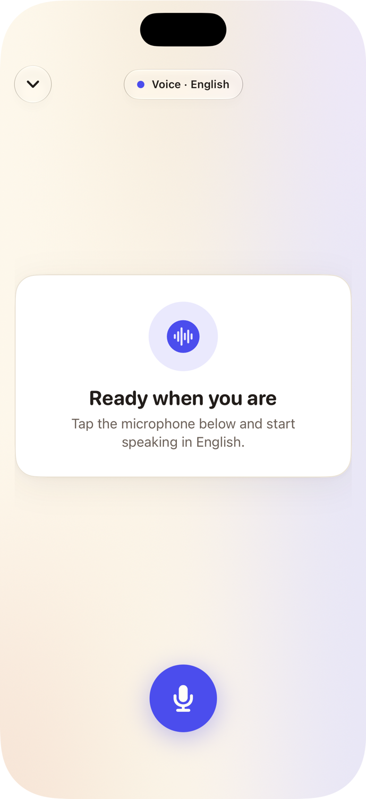
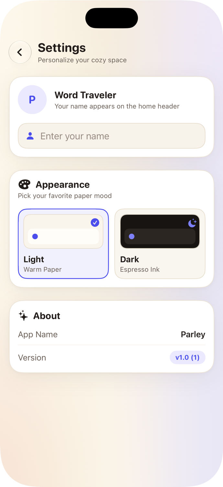
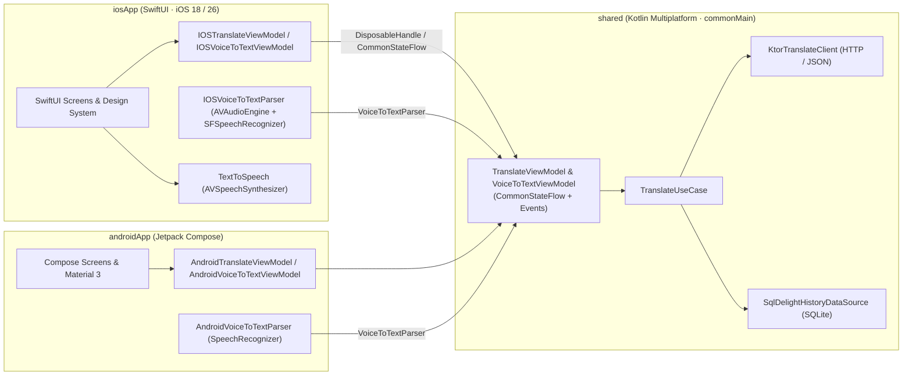

# Parley — Kotlin Multiplatform Translator

**Parley** is a cross-platform translation and voice-to-text application built with **Kotlin Multiplatform Mobile (KMM)**, **SwiftUI**, and **Jetpack Compose**. All networking, persistence, domain use cases, and presentation state machines live once in a shared Kotlin module, while each mobile app delivers a 100% native platform UI and speech/audio pipeline.

> Built as a portfolio showcase demonstrating production-minded KMM architecture: unidirectional event-driven ViewModels bridged to SwiftUI Combine/ObservableObject and Jetpack Compose, platform `expect`/`actual` drivers, an isolated iOS Design System (`Warm Paper & Indigo` + iOS 26 Liquid Glass chrome), and comprehensive unit + UI testing across platforms.

---

## Screenshots (iOS · Parley)

| Home & Quick Phrases | Translator Card States | Voice-to-Text & Diagnostics | Profile & Appearance Settings |
| :---: | :---: | :---: | :---: |
|  |  |  |  |

*(High-resolution copies are also exported to `~/Desktop/Parley-Screenshots`.)*

---

## Features

- **10-Language Bidirectional Translation**: Translate between English, Arabic, Azerbaijani, Chinese, French, German, Italian, Japanese, Korean, and Spanish with instant language swapping.
- **Voice-to-Text Capture & Live Waveform**: Native speech recognition (`SFSpeechRecognizer` + `AVAudioEngine` on iOS; `SpeechRecognizer` on Android) paired with a real-time normalized microphone power meter, actionable missing-permission diagnostics, and one-tap redirect to iOS Settings.
- **Text-to-Speech Playback**: Native `AVSpeechSynthesizer` (iOS) and Android `TextToSpeech` playback directly from translation output cards, automatically cancelling stale utterances when switching languages or clearing text.
- **Persistent Translation History**: Local SQLite persistence powered by **SQLDelight** with reactive history streams and one-tap reload into the active editor.
- **Adaptive iOS Design System ("Warm Paper & Indigo")**: Light and Espresso Ink dark palettes, animated `MeshGradient` ambient backdrop (respecting `accessibilityReduceMotion`), staggered card entrances, haptic feedback, and iOS 26 Liquid Glass floating chrome with iOS 18 material fallbacks.

---

## Architecture

Parley follows **Clean Architecture** paired with **Unidirectional Data Flow (UDF)**:

1. **Domain Layer (`commonMain`)**: Pure Kotlin models (`Language`, `HistoryItem`, `TranslateError`), use cases (`TranslateUseCase`), and platform-agnostic contracts (`TranslateClient`, `HistoryDataSource`, `VoiceToTextParser`).
2. **Data Layer (`commonMain` + `expect`/`actual`)**: `KtorTranslateClient` (HTTP client backed by platform engines `ktor-client-ios` / `ktor-client-android`) and `SqlDelightHistoryDataSource` (backed by `NativeSqliteDriver` / `AndroidSqliteDriver`).
3. **Shared Presentation Layer (`commonMain` + `iosMain`)**: `TranslateViewModel` and `VoiceToTextViewModel` consume sealed `TranslateEvent` / `VoiceToTextEvent` actions and expose reactive state via `CommonStateFlow<T>`. On iOS, `IOSMutableStateFlow` + `DisposableHandle` bridge Kotlin coroutines safely onto Swift `@MainActor` `ObservableObject` wrappers (`IOSTranslateViewModel`, `IOSVoiceToTextViewModel`).
4. **Native Platform UI**:
   - **iOS**: SwiftUI screens (`TranslateScreen`, `VoiceToTextScreen`, `SettingsScreen`) powered by a zero-KMM-dependency `design_system` module and manual `AppModule` composition root exported from `shared`.
   - **Android**: Jetpack Compose UI (`TranslateScreen`, `VoiceToTextScreen`) wired with **Hilt** dependency injection.



---

## Tech Stack

| Layer | Technology / Library | Version / Notes |
| :--- | :--- | :--- |
| **Multiplatform Core** | Kotlin Multiplatform Mobile (KMM) | Kotlin `2.1.21`, CocoaPods integration |
| **Networking** | Ktor Client (`core`, `content-negotiation`, `kotlinx-json`, `ios`, `android`) | `3.1.1` |
| **Local Persistence** | SQLDelight (`runtime`, `coroutines-extensions`, `native-driver`, `android-driver`) | `2.0.2` (`translate.sq`) |
| **Async & Dates** | Kotlinx Coroutines, Kotlinx DateTime | `kotlinx-datetime 0.6.2` |
| **iOS UI & Audio** | SwiftUI, Observation/Combine, `AVFoundation`, `Speech` | iOS `18.0+` (`#available(iOS 26.0, *)` Liquid Glass) |
| **iOS Testing** | Swift Testing (`@Suite`, `@Test`) | 66 unit & snapshot/render tests (`iosAppTests`) |
| **Android UI & DI** | Jetpack Compose (BOM `2025.06.01`), Material 3, Navigation Compose `2.9.0`, Hilt `2.51.1`, KSP | AGP `8.12.0` |
| **Shared Testing** | `kotlin-test`, `AssertK 0.26.1`, `Turbine 0.7.0` | `commonTest` + Compose E2E tests |

---

## Project Structure

```text
KMMTranslator/
├── shared/
│   └── src/
│       ├── commonMain/
│       │   ├── kotlin/.../core/           # Language enum, UiLanguage, Resource, CommonFlow helpers
│       │   ├── kotlin/.../translate/      # Domain contracts, Ktor client, SQLDelight history, TranslateViewModel
│       │   ├── kotlin/.../voice_to_text/  # VoiceToTextParser contract, VoiceToTextState/Event/ViewModel
│       │   └── sqldelight/database/       # translate.sq schema & queries
│       ├── androidMain/                   # AndroidSqliteDriver, OkHttp/Android engine, UiLanguage actuals
│       ├── iosMain/                       # NativeSqliteDriver, Darwin engine, AppModule, IOSMutableStateFlow
│       └── commonTest/                    # TranslateViewModelTest with Turbine & fakes
├── iosApp/
│   ├── iosApp/
│   │   ├── core/presentation/design_system/  # CozyTheme, CozyAmbientBackground, CozyCard, CozyFloatingChrome, etc.
│   │   ├── settings/                         # SettingsStore (@AppStorage), SettingsScreen
│   │   ├── translate/presentation/           # TranslateScreen, TranslateTextField, LanguageDropdown, TextToSpeech
│   │   └── voice_to_text/                    # IOSVoiceToTextParser, MicrophonePowerObserver, VoiceToTextScreen
│   └── iosAppTests/                          # 66 Swift Testing specs (ViewModels, Parser, Audio, Design System, Settings)
├── androidApp/
│   └── src/main/java/.../                    # Hilt DI modules, Compose UI, AndroidVoiceToTextParser
├── docs/screenshots/                         # Rendered UI showcase images
└── rebuild_ios_framework.sh                  # Rebuilds shared.framework CocoaPod for Xcode
```

---

## Getting Started

### Prerequisites

- **Xcode 16+** (with iOS 18+ Simulator runtime) & **CocoaPods**
- **Android Studio** (Ladybug / Meerkat+) with JDK 17+
- **Kotlin Multiplatform** plugin (optional for IDE navigation)

### Running Shared & Android Builds / Tests

```bash
# Run shared & unit tests
./gradlew test

# Build Android debug APK
./gradlew :androidApp:assembleDebug

# Run shared module tests only
./gradlew :shared:testDebugUnitTest
```

### Building & Running on iOS

1. Rebuild the KMM CocoaPod framework if you modified Kotlin code in `shared`:
   ```bash
   ./rebuild_ios_framework.sh
   ```
2. Open the Xcode workspace (**not** `.xcodeproj`):
   ```bash
   open iosApp/iosApp.xcworkspace
   ```
3. Select the `iosApp` scheme and an iOS Simulator (or physical device for live microphone dictation) and press **Run (`⌘R`)** or **Test (`⌘U`)**.

> **Note on Voice Recording in iOS Simulator**: Live microphone capture requires hardware audio input routing. On simulators without an active input node or when Microphone / Speech Recognition permissions are turned off, Parley surfaces explicit permission status pills, diagnostics, and an **Open Settings** redirect instead of failing silently.
